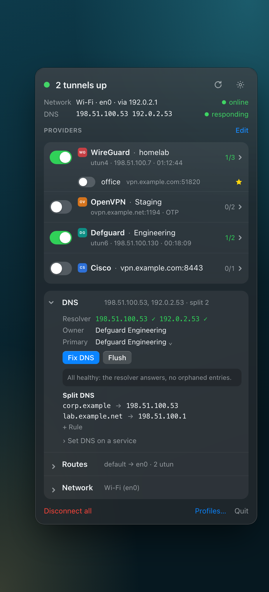
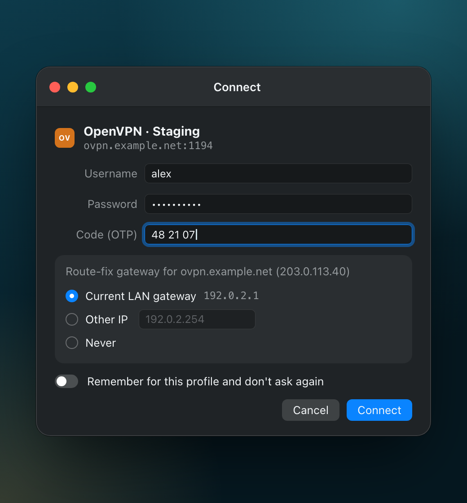
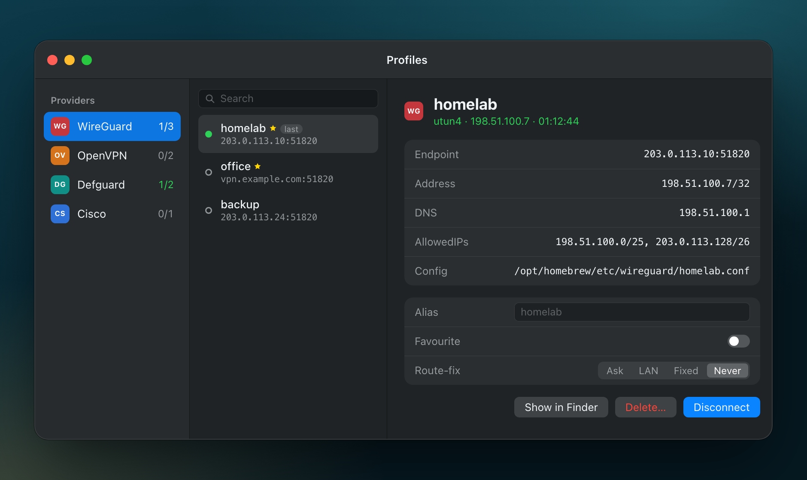

# StoneVPN Management

<div align="leading">

[](https://github.com/foxfollow/stone-vpn-managment/releases/latest)

[](https://github.com/foxfollow/homebrew-stone)
[](LICENSE)

</div>

<p align="center">
  
</p>

**One menu bar for every VPN on macOS.** **StoneVPN Manager** is a free, open-source menu bar app that
puts **WireGuard**, **OpenVPN**, **Defguard** and **Cisco Secure Client** behind one icon — and fixes the
DNS and routing mess VPNs leave behind: dead resolvers, orphaned DNS entries, routes out of the wrong
interface, an Ethernet port without internet stealing Wi-Fi.

Underneath is the Bash toolkit it grew out of — `main-vpn-manager.sh` — which still works on its own.

**[Website](https://foxfollow.github.io/stone-vpn-managment/)** ·
**[Installation guide](https://foxfollow.github.io/stone-vpn-managment/installation.html)** ·
**[Releases](https://github.com/foxfollow/stone-vpn-managment/releases)** ·
**[Homebrew tap](https://github.com/foxfollow/homebrew-stone)** ·
**[Українською](README.uk.md)**

<p align="center">
  
  &nbsp;
  
</p>
<p align="center"><sub>Mockups with made-up data. The app interface is currently in Ukrainian; labels are translated here for illustration.</sub></p>

---

## Install

### Homebrew (recommended)

```bash
brew tap foxfollow/stone
brew trust --tap foxfollow/stone
brew install --cask stone-vpn-manager
```

Requires **macOS 26 Tahoe** or later (universal: Apple silicon + Intel). Then install the backends you use:

```bash
brew install wireguard-tools openvpn   # Defguard and Cisco Secure Client come from their vendors
```

### Manual download

Get `StoneVPNManager.zip` from the [latest release](https://github.com/foxfollow/stone-vpn-managment/releases/latest),
move `StoneVPNManager.app` to `/Applications`, then once:

```bash
xattr -cr /Applications/StoneVPNManager.app
```

The app is ad-hoc signed (no paid Apple Developer ID). Updates are delivered by Sparkle and verified with an
EdDSA signature. Full walkthrough (first launch, helper, backends, uninstall):
**[installation guide](https://foxfollow.github.io/stone-vpn-managment/installation.html)**.

### First launch

1. A shield appears in the menu bar (no Dock icon).
2. Allow **Local Network** when macOS asks — the DNS/internet probes talk to resolvers in your LAN.
3. Settings → Helper → **Install**, then approve it in System Settings → General → Login Items.
   Without the helper every root action asks for the administrator password.

---

## Features

| | |
|---|---|
| **Four VPNs, one switchboard** | WireGuard (`wg-quick`), OpenVPN (Homebrew `openvpn` — writes routes correctly, unlike the GUI), Defguard with MFA, Cisco Secure Client with in-app login and Duo push. Favourites, aliases, last used. |
| **DNS doctor** | Detects a dead resolver, purges entries of dead tunnels, bounces the service so macOS really recomputes DNS — and says so when a live-but-broken VPN is the problem. |
| **Primary DNS & split DNS** | Choose whose resolver answers first (WireGuard, Cisco, Defguard, system); `/etc/resolver` rules edited in place with sanity checks. |
| **DNS guard after WireGuard** | `wg-quick` leaves its DNS on every service; the app remembers each service's baseline and restores it. |
| **Route-fix & VPN-in-VPN** | Host routes to VPN servers via the LAN gateway, per profile; stale routes from a previous network are purged before every connect. |
| **Network priority** | Real per-interface reachability; put the service that actually has internet on top (Auto). |
| **Stale Defguard sessions** | Detects an MFA session the gateway dropped while macOS still says "Connected"; renews with a new code. |
| **Privileged helper** | A root daemon that accepts only the app's own signature and a fixed set of validated operations. |
| **CLI parity** | `main-vpn-manager.sh` does the same from the terminal; app and CLI share `config.env` / `state.env`, or the app runs standalone. |

The menu bar icon shows state by colour: grey outline — no tunnels, green + number — tunnels up,
orange — connecting, red "!" — DNS/network problem, purple — a foreign VPN owns the network.

<p align="center">
  
</p>

---

## Repository layout

```
.
├── main-vpn-manager.sh     # ← CLI entry point (WireGuard · OpenVPN · Defguard · Cisco)
├── OPENVPN_CLI.md          # OpenVPN scripts in detail (Ukrainian)
├── config.env.example      # template for local defaults
├── config.env              # (gitignored) LAN_GATEWAY, OVPN_USERNAME, RESTORE_DNS, DISABLED_BACKENDS…
├── state.env               # (gitignored, auto) last choices: LAST_GATEWAY, LAST_USERNAME
├── auth.txt.example        # template for the default OpenVPN login
├── scripts/                # vpn-up/down, vpn-cert, wg-cert, DNS/agent helpers
├── app/                    # StoneVPN Manager (SwiftUI, macOS 26+)
│   ├── Makefile            #   make build | install | test | status
│   ├── Packages/StoneVPNKit/   core without UI (models, parsers, actions, helper protocol) + tests
│   └── StoneVPNManager/    #   Xcode project: app, privileged helper, launchd plist
├── docs/                   # website (GitHub Pages) + Sparkle appcast + RELEASING.md
├── tools/render-screens.sh # renders the website mockups into README images
└── .github/workflows/      # CI (tests/build/shellcheck) and the release pipeline
```

WireGuard configs (`.conf`) live in the system `wg-quick` dirs (`/etc/wireguard`, `/usr/local/etc/wireguard`,
`/opt/homebrew/etc/wireguard`), **not** in this repo. OpenVPN profiles (`.ovpn`) live in
`~/Library/Application Support/OpenVPN Connect/profiles/`.

---

## CLI: `main-vpn-manager.sh`

```bash
git clone https://github.com/foxfollow/stone-vpn-managment.git && cd stone-vpn-managment
./main-vpn-manager.sh <command> [tunnel]
```

| Command              | What it does |
|----------------------|--------------|
| `status`             | quick status: all live tunnels (WireGuard + OpenVPN + Defguard + utun), primary network, resolver |
| `list`               | available tunnels (WG configs, `openvpn`, Defguard locations, Cisco hosts) |
| `up <tunnel>`        | bring up a WG tunnel by name, `openvpn`, `cisco [host]` or `defguard [location]` |
| `down [tunnel]`      | take one down; without an argument — all (shows status first) |
| `cert <wg\|openvpn>` | add / manage configs and certificates |
| `dns [fix]`          | DNS per service; `dns fix` repairs DNS a VPN broke |
| `route`              | who holds the default route (VPN hijack / dead uplink), every VPN route |
| `net [auto\|top]`    | network service order: Wi-Fi vs Ethernet |
| `help`               | help |

```bash
./main-vpn-manager.sh status            # what is up right now
./main-vpn-manager.sh up homelab        # WireGuard tunnel by name
./main-vpn-manager.sh up openvpn        # interactive profile menu + OTP prompt
./main-vpn-manager.sh down              # everything (asks for confirmation)
./main-vpn-manager.sh cert wg           # generate/import a WireGuard tunnel
```

`up`/`down` call `sudo` themselves (tun interface, `wg-quick`). Defguard needs no `sudo`.
CLI output is in Ukrainian.

### Disable backends

```bash
DISABLED_BACKENDS="cisco openvpn"   # in config.env: wireguard | openvpn | defguard | cisco
```

A disabled backend is neither shown nor probed. One-off: `DISABLED_BACKENDS=cisco ./main-vpn-manager.sh status`.

### Cisco Secure Client

Uses the CLI `/opt/cisco/secureclient/bin/vpn` instead of the GUI (`up cisco [host]`, `down cisco`). The `vpn`
binary asks for group, login, password and banner itself — nothing is stored. While the Cisco GUI is open the
CLI cannot connect, so `up cisco` offers to quit it (the tunnel lives in `vpnagentd`, not the GUI).

### Defguard

Needs the [Defguard desktop client](https://docs.defguard.net/) with an instance already added. On macOS it is
a NetworkExtension: each location is its own VPN service, connected via `defguard-client` from `Defguard.app`.

```bash
./main-vpn-manager.sh up defguard                       # location menu; the CLI asks for the MFA code
./main-vpn-manager.sh up defguard team --all-traffic    # extra args → defguard-client connect
./main-vpn-manager.sh down defguard
```

> **Don't symlink** `defguard-client` into `PATH`: NetworkExtension derives the app bundle from the exec path
> and fails with `Failed to save tunnel configuration … to system settings`. Use a wrapper instead:
> `printf '#!/bin/sh\nexec /Applications/Defguard.app/Contents/MacOS/defguard-client "$@"\n' > /opt/homebrew/bin/defguard-client && chmod +x /opt/homebrew/bin/defguard-client`

### WireGuard — add a tunnel

`./main-vpn-manager.sh cert wg` generates a key pair and a `.conf` (or imports an existing one) into the system
WireGuard dir (`sudo`, mode 600) and prints your **public key** for the server admin.

### OpenVPN

```bash
cp config.env.example config.env                     # optional defaults: LAN_GATEWAY, OVPN_USERNAME
./main-vpn-manager.sh cert openvpn                   # add .ovpn profile(s)
./main-vpn-manager.sh up openvpn
```

Login is asked only if the profile has `auth-user-pass`; OTP/password are never stored.
Details (Ukrainian): [OPENVPN_CLI.md](OPENVPN_CLI.md).

### DNS after disconnect, Ethernet without internet

- `wg-quick` sometimes leaves a dead WG DNS after `down`. Set `RESTORE_DNS=…` and `DNS_SERVICES=(…)` in
  `config.env`, or run `./main-vpn-manager.sh dns` / `dns fix`.
- macOS picks the primary interface by **service order**, not by internet. `./main-vpn-manager.sh net` shows
  where internet really is, `net auto` puts that service on top.

---

## Development

```bash
make -C app test      # unit tests of StoneVPNKit
make -C app install   # Release build → /Applications (the helper needs that location)
make -C app status    # status without UI — compare with ./main-vpn-manager.sh status
```

Builds from source are signed with your team and don't run the auto-updater. Releases are built by
GitHub Actions on a `vX.Y.Z` tag (ad-hoc signing, Sparkle appcast, Homebrew cask bump) —
see [docs/RELEASING.md](docs/RELEASING.md). Website mockups → README images: `tools/render-screens.sh`.

## Security

A personal tool provided **as is**, without warranty: it runs commands as root and changes routes, DNS and
network interfaces. Read the code before running it. Secrets (`auth.txt`, `config.env`, `state.env`, keys,
`.conf`, `.ovpn`) are gitignored — see [SECURITY.md](SECURITY.md).

## License

[MIT](LICENSE) © 2026 foxfollow
