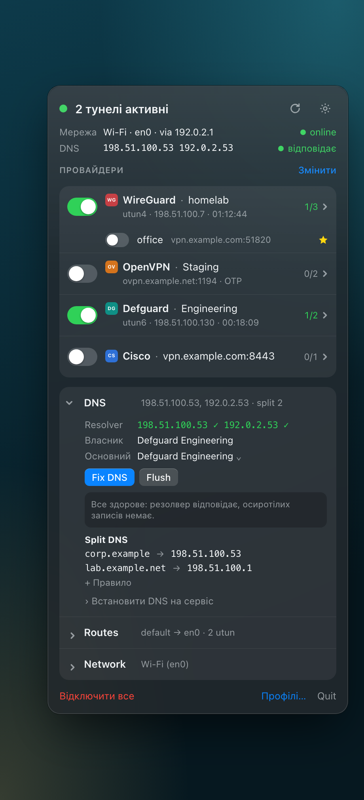
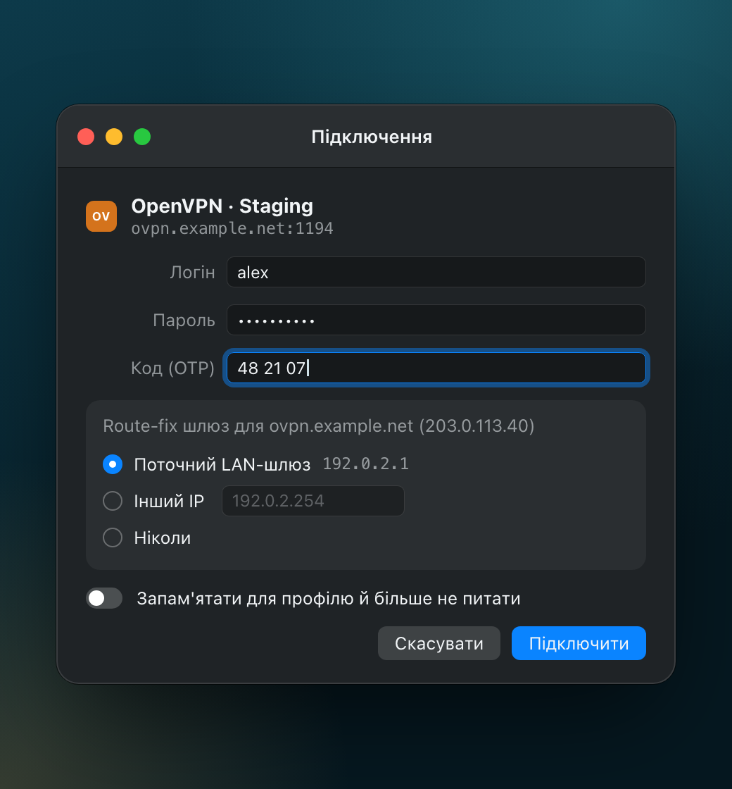
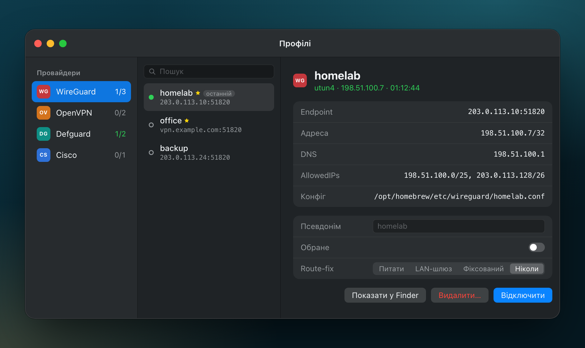

# StoneVPN Management

<div align="leading">

[](https://github.com/foxfollow/stone-vpn-managment/actions/workflows/ci.yml)
[](https://github.com/foxfollow/stone-vpn-managment/actions/workflows/codeql.yml)
[](https://sonarcloud.io/summary/new_code?id=foxfollow_stone-vpn-managment)
[](https://github.com/foxfollow/stone-vpn-managment/actions/workflows/shellcheck.yml)

[](https://github.com/foxfollow/stone-vpn-managment/releases/latest)

[](https://github.com/foxfollow/homebrew-stone)
[](LICENSE)

</div>

<p align="center">
  
</p>

**Одна іконка в menubar для всіх VPN на macOS.** **StoneVPN Manager** — безкоштовний open-source
menubar-застосунок, що збирає **WireGuard**, **OpenVPN**, **Defguard** і **Cisco Secure Client** в одному місці
і лагодить те, що VPN після себе ламають: мертві резолвери, осиротілі DNS-записи, маршрути не через той
інтерфейс, Ethernet без інтернету, що перебиває Wi-Fi.

Під ним — набір bash-скриптів, з якого він виріс: `main-vpn-manager.sh` — **одна централізована точка
керування** тунелями (WireGuard через `wg-quick`, OpenVPN через Homebrew-версію `/opt/homebrew/sbin/openvpn`,
Defguard через `defguard-client`, Cisco через його CLI). Скрипти працюють і без застосунку.
Brew-версія OpenVPN (на відміну від GUI OpenVPN Connect) правильно прописує маршрути в ядро, тому
використовується саме вона.

**[Сайт](https://foxfollow.github.io/stone-vpn-managment/index-ua.html)** ·
**[Інструкція зі встановлення](https://foxfollow.github.io/stone-vpn-managment/installation-ua.html)** ·
**[Релізи](https://github.com/foxfollow/stone-vpn-managment/releases)** ·
**[Homebrew tap](https://github.com/foxfollow/homebrew-stone)** ·
**[English](README.md)**

<p align="center">
  
  &nbsp;
  
</p>
<p align="center"><sub>Макети з вигаданими даними.</sub></p>

---

## Встановлення

### Homebrew (рекомендовано)

```bash
brew tap foxfollow/stone
brew trust --tap foxfollow/stone
brew install --cask stone-vpn-manager
```

Потрібна **macOS 26 Tahoe** або новіша (universal: Apple silicon + Intel). Далі — бекенди, якими користуєшся:

```bash
brew install wireguard-tools openvpn   # Defguard і Cisco Secure Client — від їхніх розробників
```

### Вручну

Завантаж `StoneVPNManager.zip` з [останнього релізу](https://github.com/foxfollow/stone-vpn-managment/releases/latest),
перенеси `StoneVPNManager.app` у `/Applications` і один раз виконай:

```bash
xattr -cr /Applications/StoneVPNManager.app
```

Застосунок підписаний ad-hoc (без платного Apple Developer ID). Оновлення приходять через Sparkle й
перевіряються підписом EdDSA. Покроково (перший запуск, helper, бекенди, видалення):
**[інструкція](https://foxfollow.github.io/stone-vpn-managment/installation-ua.html)**.

---

## Структура

```
.
├── main-vpn-manager.sh     # ← головна точка входу CLI (WireGuard · OpenVPN · Defguard · Cisco)
├── OPENVPN_CLI.md          # детальна інструкція по OpenVPN-скриптах
├── config.env.example      # шаблон локального конфігу (дефолти)
├── config.env              # (gitignored) дефолти: LAN_GATEWAY, OVPN_USERNAME
├── state.env               # (gitignored, авто) останні вибори: LAST_GATEWAY, LAST_USERNAME
├── auth.txt.example        # шаблон файлу логіну
├── auth.txt                # (gitignored, опц.) дефолтний OpenVPN-логін, chmod 600
├── LICENSE                 # MIT
├── SECURITY.md             # дисклеймер + правила поводження з секретами
├── README.md               # англійською (основний)
├── docs/                   # сайт (GitHub Pages) + Sparkle appcast + RELEASING.md
├── tools/render-screens.sh # макети сайту → картинки для README
├── .github/workflows/      # CI (тести/збірка/shellcheck) і реліз
└── scripts/                # допоміжні скрипти
    ├── vpn-up.sh                       # OpenVPN: підключення (динамічне меню + логін + route-fix)
    ├── vpn-down.sh                     # OpenVPN: відключення
    ├── vpn-cert.sh                     # OpenVPN: керування профілями/сертифікатами
    ├── wg-cert.sh                      # WireGuard: генерація/імпорт/видалення конфігів
    ├── fix-ovpnagent.sh                # перезапуск агента OpenVPN Connect
    ├── nuclear-clean-dns.sh            # примусове очищення DNS
    └── com.local.ovpnagent-watchdog.plist  # LaunchDaemon-вотчдог агента

app/                            # StoneVPN Manager — menubar-застосунок
├── Makefile                    # make build | install | test | status
├── Packages/StoneVPNKit/       # ядро без UI (локальний Swift-пакет)
│   ├── Sources/StoneVPNCore/   #   Model · Parsing · System · Actions · Config · Backends
│   ├── Sources/StoneVPNShared/ #   протокол застосунок ↔ helper
│   └── Tests/StoneVPNCoreTests/
└── StoneVPNManager/
    ├── StoneVPNManager.xcodeproj
    ├── StoneVPNManager/        # застосунок: App · Services · Views · Resources (AppIcon.icon)
    ├── StoneVPNManagerHelper/  # privileged helper (root-демон)
    └── Config/                 # Info.plist-доповнення, plist launchd-демона
```

> WireGuard-конфіги (`.conf`) живуть у системних шляхах wg-quick
> (`/etc/wireguard`, `/usr/local/etc/wireguard`, `/opt/homebrew/etc/wireguard`),
> **не** в цьому репозиторії. OpenVPN-профілі (`.ovpn`) — у
> `~/Library/Application Support/OpenVPN Connect/profiles/`.

---

## StoneVPN Manager (menubar-застосунок)

Іконка в menubar показує стан кольором (сірий контур — тунелів немає, зелений + число —
скільки підключено, помаранчевий — підключається, червоний «!» — проблема з DNS/мережею,
фіолетовий — мережу тримає сторонній VPN). Без іконки в Dock.

- **Поповер:** мережа і DNS (з перевіркою, чи резолвер відповідає), список провайдерів —
  зліва перемикач останнього профілю, під ним обрані ★, `›` відкриває всі профілі;
  «Змінити» — порядок і приховування. Розгортні DNS (Fix / Flush / split), Routes, Network (Auto).
- **Підключення:** OpenVPN (логін + OTP, route-fix), Defguard (MFA-код), Cisco прямо в
  застосунку (групи підтягуються з сервера, логін/хост з порту — з налаштувань Cisco;
  пароль не зберігається), WireGuard.
- **Профілі:** псевдоніми (зручно для `.ovpn` з ms-timestamp-назвами), обрані, route-fix
  для кожного профілю (питати / LAN-шлюз / фіксований / ніколи), власні Cisco-хости `host:port`.
- **DNS:** перемикач «Основний DNS» — чий резолвер питати першим для всіх доменів (Cisco,
  WireGuard, Defguard або як вирішила система; скидається сам, коли обраний тунель падає);
  split-правила редагуються на місці, з підказкою DNS активних тунелів і попередженнями про
  типові помилки (адреса інтерфейсу замість DNS-сервера, «домен» без крапки).
- **Налаштування:** бічне меню з групами й пошуком по всіх пунктах; ті самі ключі, що в
  `config.env` (спільні з CLI), сповіщення, Auto DNS fix (вимкнено за замовчуванням), helper.
- **Мова:** українська й англійська — за мовою системи; перевизначити — Налаштування → Загальні.
- **Без репо:** якщо `main-vpn-manager.sh` не знайдено або «Спільно з CLI» вимкнено,
  налаштування живуть у `~/Library/Application Support/StoneVPNManager/`.

```bash
make -C app install   # зібрати Release і встановити в /Applications
make -C app test      # unit-тести ядра
make -C app status    # стан без UI — порівняти з ./main-vpn-manager.sh status
```

Збірки з коду підписані твоєю командою й не запускають автооновлення. Релізи збирає GitHub Actions
за тегом `vX.Y.Z` (ad-hoc підпис, Sparkle appcast, оновлення Homebrew cask) — див.
[docs/RELEASING.md](docs/RELEASING.md).

<p align="center">
  
</p>

Root-дії (wg-quick, openvpn, DNS, маршрути) виконує **privileged helper**:
Settings → Helper → «Встановити», далі схвалити в System Settings → Login Items.
Helper приймає лише сам застосунок (той самий Team ID, а в ad-hoc релізах — саме той бандл, у якому
лежить) і виконує фіксований набір перевірених дій. Без нього кожна така дія разово питає пароль адміністратора.
macOS також один раз спитає дозвіл **Local Network** — це для перевірки DNS-резолвера
в LAN і доступності інтернету через інтерфейси.

---

## Використання `main-vpn-manager.sh`

```bash
./main-vpn-manager.sh <команда> [тунель]
```

| Команда             | Опис                                                          |
|---------------------|--------------------------------------------------------------|
| `status`            | швидкий статус: усі активні тунелі (WireGuard + OpenVPN + Defguard + utun) |
| `list`              | доступні тунелі (WG-конфіги + `openvpn` + Defguard-локації)   |
| `up <тунель>`       | підняти тунель: назва WG-тунелю, `openvpn`, `cisco [хост]` або `defguard [локація]` |
| `down [тунель]`     | опустити тунель; без аргументу — всі (спершу показує статус)  |
| `cert <wg\|openvpn>`| додати/керувати конфігами та сертифікатами                    |
| `dns [fix]`         | DNS по сервісах; `dns fix` — полагодити DNS, вбитий VPN       |
| `route`             | хто тримає default-маршрут (VPN-перехоплення / мертвий аплінк) |
| `net [auto\|top]`   | порядок мережевих сервісів: Wi-Fi vs Ethernet                 |
| `help`              | довідка                                                       |

### Приклади

```bash
# Подивитись що зараз активне
./main-vpn-manager.sh status

# Які тунелі взагалі доступні
./main-vpn-manager.sh list

# Підняти WireGuard-тунель за назвою
./main-vpn-manager.sh up homelab

# Підключити OpenVPN (відкриє інтерактивне меню профілів + запит OTP)
./main-vpn-manager.sh up openvpn

# Опустити конкретний тунель
./main-vpn-manager.sh down homelab

# Опустити ВСЕ (покаже статус і запитає підтвердження)
./main-vpn-manager.sh down

# Додати/згенерувати WireGuard-тунель або керувати .ovpn профілями
./main-vpn-manager.sh cert wg
./main-vpn-manager.sh cert openvpn
```

`up`/`down` потребують `sudo` (створення tun-інтерфейсу та `wg-quick`).
Скрипт викличе `sudo` сам — буде запит пароля. Defguard — без `sudo`.

---

## Вимкнути бекенди

Якщо якимось VPN не користуєшся — у `config.env`:

```bash
DISABLED_BACKENDS="cisco openvpn"   # wireguard | openvpn | defguard | cisco
```

Вимкнений бекенд не показується в `status` / `list` / меню `down` і не опитується
(жодних викликів його CLI). `up`/`down` для нього відмовлять з поясненням. За
замовчуванням увімкнено все. Разово, без правки конфігу:
`DISABLED_BACKENDS=cisco ./main-vpn-manager.sh status`.

## Cisco Secure Client

Через CLI `/opt/cisco/secureclient/bin/vpn` замість GUI:

```bash
./main-vpn-manager.sh list          # хости з профілю Cisco (+ який під'єднаний)
./main-vpn-manager.sh up cisco      # один хост — одразу; кілька — меню; або: up cisco <адреса>
./main-vpn-manager.sh down cisco
```

Групу, логін, пароль і банер питає сам `vpn` у терміналі — скрипт нічого не зберігає.
Поки відкритий GUI Cisco Secure Client, CLI підключати не може — `up cisco` запропонує
закрити GUI (тунель тримає `vpnagentd`, не GUI).

## Defguard

Потрібен встановлений [Defguard desktop client](https://docs.defguard.net/using-defguard-for-end-users/desktop-client/command-line-defguard-cli)
з уже доданим інстансом. На macOS це NetworkExtension (`net.defguard`): кожна локація —
окремий VPN-сервіс у системі, підключення йде через `defguard-client` (входить у
`Defguard.app`, ділить БД із GUI).

```bash
./main-vpn-manager.sh list                       # локації: endpoint, MFA, routing
./main-vpn-manager.sh up defguard                # меню локацій; MFA-код спитає CLI
./main-vpn-manager.sh up staff                   # голе ім'я, якщо немає WG-конфігу з такою назвою
./main-vpn-manager.sh up defguard staff --all-traffic   # решта аргументів → defguard-client connect
./main-vpn-manager.sh down defguard              # усі Defguard-сесії (або: down defguard staff)
./main-vpn-manager.sh net top staff              # Defguard-сервіс на верх порядку сервісів
```

`status` показує utun, маршрути й DNS кожної сесії; `route` підписує її utun як
«Defguard <локація>». DNS локації Defguard ставить для **всіх** доменів і першим у
резолвері (як Cisco) — поки тунель піднятий, усі запити спершу йдуть на нього.

> **Не робіть симлінк** на `defguard-client` у `PATH`. NetworkExtension шукає бандл
> застосунку від шляху запуску, і через симлінк не знаходить розширення:
> `Failed to save tunnel configuration … to system settings`. Локація без MFA при
> цьому ще працює (старий профіль валідний), а MFA-локація падає. Якщо потрібна
> команда в `PATH` — обгортка:
>
> ```sh
> printf '#!/bin/sh\nexec /Applications/Defguard.app/Contents/MacOS/defguard-client "$@"\n' \
>   > /opt/homebrew/bin/defguard-client && chmod +x /opt/homebrew/bin/defguard-client
> ```
>
> `main-vpn-manager.sh` сам завжди запускає справжній бінарник із бандла.

---

## WireGuard — додавання тунелю

```bash
./main-vpn-manager.sh cert wg
```

- **Згенерувати новий** — створює пару ключів (`wg genkey`/`wg pubkey`), питає
  Address / DNS / Endpoint / PublicKey піра / AllowedIPs, збирає `.conf` і кладе у
  системну теку WireGuard (`sudo`, права 600). Виводить твій **публічний ключ** —
  передай його адміну сервера.
- **Імпортувати готовий** — `scripts/wg-cert.sh /path/to/tunnel.conf` покладе
  наданий `.conf` у системну теку.

Далі: `./main-vpn-manager.sh up <назва-тунелю>`.

---

## OpenVPN

Деталі по OpenVPN-частині (меню профілів, OTP, керування сертифікатами,
відновлення агента) — у [OPENVPN_CLI.md](OPENVPN_CLI.md).

Швидкий старт:

```bash
cp config.env.example config.env                     # (опц.) дефолти: LAN_GATEWAY, OVPN_USERNAME
cp auth.txt.example auth.txt && chmod 600 auth.txt   # (опц.) дефолтний логін
./main-vpn-manager.sh cert openvpn                   # додати .ovpn профіль(і)
./main-vpn-manager.sh up openvpn                     # підключитись (динамічне меню)
```

Логін питається лише якщо профіль має `auth-user-pass`; його можна змінити або
пропустити при підключенні. OTP/пароль ніде не зберігаються.

---

## DNS після відключення

`wg-quick` після відключення інколи лишає неробочий DNS від WG (втрачаєш інтернет).
Щоб цього уникнути, задай у `config.env`:

```bash
RESTORE_DNS=8.8.8.8         # або "8.8.8.8 8.8.4.4"; порожньо = не чіпати DNS
DNS_SERVICES=("Wi-Fi")     # сервіси: networksetup -listallnetworkservices
```

Після `down` менеджер застосує цей DNS до вказаних сервісів. Якщо `RESTORE_DNS`
порожній — DNS не чіпається взагалі.

Автоматичне відновлення стосується лише сервісів зі списку `DNS_SERVICES`. Якщо
користуєшся й іншими інтерфейсами (Ethernet, USB LAN тощо) — скористайся
інтерактивною командою: вона покаже DNS усіх сервісів і дасть встановити свій на
вибраних (або на всіх):

```bash
./main-vpn-manager.sh dns
```

---

## Ethernet без інтернету перебиває Wi-Fi

macOS обирає первинний інтерфейс не за наявністю інтернету, а за **порядком
мережевих сервісів**: виграє найвищий сервіс, у якого є IPv4 зі шлюзом. Тому
USB-Ethernet, увімкнений у роутер без аплінку, забирає весь трафік — шлюз є,
інтернету немає, все висне.

```bash
./main-vpn-manager.sh net          # список сервісів + де інтернет РЕАЛЬНО є
./main-vpn-manager.sh net auto     # підняти на верх той, у якого інтернет є
./main-vpn-manager.sh net top "Wi-Fi"   # назавжди зробити Wi-Fi першим
```

`net` пінгує кожен інтерфейс із прив'язкою до нього (`ping -b`), тому бачить
різницю між «шлюз є» і «інтернет є». Правити це через `route change default`
марно: `configd` перепише маршрут при першій же зміні стану мережі — постійним
є лише порядок сервісів.

---

## Застереження

- **Не комітити** `auth.txt`, `config.env`, `state.env`, `*.key`, `*.conf`, `*.ovpn`,
  ключі WireGuard — вони містять логіни/ключі/сертифікати/мережеві деталі. Усе це у
  `.gitignore`; комітяться лише `*.example`-шаблони.
- **Не змінювати** системні шляхи WireGuard — `wg-quick` очікує конфіги саме
  у своїх стандартних директоріях.

---

## Безпека

Інструмент для **особистого використання**, надається «як є», без гарантій;
виконує команди з `sudo` і змінює маршрути/DNS/інтерфейси. Перед запуском —
прочитай скрипти. Деталі та правила поводження з секретами — у
[SECURITY.md](SECURITY.md).

## Ліцензія

[MIT](LICENSE) © 2026 foxfollow
